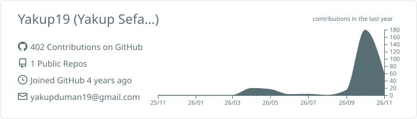
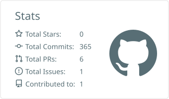
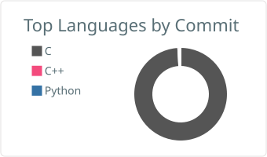

<!--
  =====================================================================
  GitHub Profile README — Yakup Sefa Duman  (repo: Yakup19/Yakup19)
  ---------------------------------------------------------------------
  Sections:
    1. Header            5. GitHub Activity
    2. About Me          6. How I Work
    3. Selected Work     7. Currently
    4. Tech Stack        8. Connect
  HTML comments like this one are invisible on GitHub.
  Lines marked [EDIT] are the places you are most likely to update.
  =====================================================================
-->

<!-- ===================== 1. HEADER ===================== -->
<h1 align="center">Yakup Sefa Duman</h1>

  <b>Embedded Software Engineer</b> 
  Firmware &nbsp;·&nbsp; Hardware Design &nbsp;·&nbsp; System Integration

<!-- [EDIT] One-line tagline -->

<i>From schematic to firmware — I build embedded systems end to end.</i>

  
  

 

<!-- ===================== 2. ABOUT ME ===================== -->
## About Me

I'm an embedded software engineer with a mechatronics background, working where firmware meets hardware: microcontrollers, low-level programming, board design and system integration. Embedded systems aren't just my job; they're the part of engineering I enjoy most.

I like owning a system from the first schematic to the last line of firmware. I design the hardware, bring up the board, write the firmware and verify the result on the bench with an oscilloscope and logic analyzer. When I solve problems, I start from the hardware, define clear states and failure modes, and test early, including before the firmware ever touches the board.

I'm currently pursuing a thesis-based **MSc in Defense Electronics Engineering** at Gebze Technical University and keep expanding my toolset, with **C++** and **RTOS** next on the list.

<!-- ===================== 3. SELECTED WORK ===================== -->
## Selected Work

> The source code for these projects is private or proprietary. Each description covers only my own contribution.

<!-- [EDIT] To add a project, copy one block (### title → bullets).
     If a project becomes public later, add a line under the title:
     <a href="https://github.com/Yakup19/REPO">Repository</a> -->

### DDS Frequency Generator Board — Therapy Device

-A8B9CC?style=flat-square&logo=c&logoColor=black)

I was the sole developer on a control board that generates adjustable frequencies below 1 MHz. I did the schematic, the 2-layer PCB, board bring-up and all of the firmware.
- Designed a layered firmware architecture (driver / application) built around a **state machine**
- Drove the **AD9833 DDS** over hardware SPI for adjustable output frequency
- Integrated a **Nextion HMI** over UART for parameter control; parameters are stored in external flash memory
- Tested the firmware on a **virtual twin of the MCU** before flashing, then ran functional tests on the boards with an oscilloscope

### LoRa OTA Bootloader

A bootloader that receives new firmware **over the air through a LoRa link** and updates an STM32.
- Firmware integrity is verified with **CRC32**
- If data arrives corrupted or the transfer is cut off, the MCU keeps running unaffected

### Vehicle Control Unit — TEKNOFEST Efficiency Challenge

I wrote all of the vehicle control software on STM32 except the telemetry. The team reached the **TEKNOFEST Efficiency Challenge finals three years in a row**. I also wrote technical reports and design documents for the competition.

<!-- ===================== 4. TECH STACK ===================== -->
## Tech Stack

<!-- [EDIT] Only list what you actually use. "basic" marks entry-level skills. -->

**Languages** 

**Microcontrollers** 

**Protocols & Interfaces** 

**Hardware Design & Debugging** 

**Tools** 

**Practices** 

<!-- ===================== 5. GITHUB ACTIVITY ===================== -->
## GitHub Activity

<!-- Most of my work lives in private repositories. These cards show real data:
     - Streak: GitHub contribution calendar (requires "Private contributions" enabled in profile settings)
     - Summary cards + snake: generated by GitHub Actions in this repo
       (.github/workflows/summary-cards.yml and snake.yml)
     Images will appear broken until the workflows have run once. -->

  <picture>
    <source media="(prefers-color-scheme: dark)" srcset="https://streak-stats.demolab.com/?user=Yakup19&theme=dark&hide_border=true&background=0D1117">
    
  </picture>

  <picture>
    <source media="(prefers-color-scheme: dark)" srcset="./profile-summary-card-output/github_dark/0-profile-details.svg">
    
  </picture>

  <picture>
    <source media="(prefers-color-scheme: dark)" srcset="./profile-summary-card-output/github_dark/3-stats.svg">
    
  </picture>
  <picture>
    <source media="(prefers-color-scheme: dark)" srcset="./profile-summary-card-output/github_dark/2-most-commit-language.svg">
    
  </picture>

  <picture>
    <source media="(prefers-color-scheme: dark)" srcset="https://raw.githubusercontent.com/Yakup19/Yakup19/output/github-snake-dark.svg">
    
  </picture>

<!-- ===================== 6. HOW I WORK ===================== -->
## How I Work

- **End-to-end ownership.** I take a system from requirements through schematic, PCB, bring-up and firmware to test.
- **Design for failure.** I define states and error paths up front so a broken transfer or bad input never leaves the device in an unknown state.
- **Test before the hardware does.** I verify logic on a virtual twin first, then on the bench with an oscilloscope and logic analyzer.
- **Readable, layered C.** I separate drivers from application logic and follow the Barr-C coding standard.
- **Document the work.** I write technical reports and design documents alongside the code.

<!-- [EDIT] Once you contribute to open-source projects, add a line here:
- **Open source.** Contributions to <project> (<link>) -->

<!-- ===================== 7. CURRENTLY ===================== -->
## Currently

- Pursuing an MSc in Defense Electronics Engineering at Gebze Technical University
- Learning **C++** and **RTOS**
<!-- [EDIT] Optional, if you want recruiters to know:
- Open to embedded software engineering roles -->

**Education:** BSc Mechatronics Engineering, Kocaeli University (2025) · MSc Defense Electronics Engineering, Gebze Technical University (in progress)

<!-- ===================== 8. CONNECT ===================== -->
## Connect

  &nbsp;
  

LinkedIn: [yakup-sefa-duman](https://www.linkedin.com/in/yakup-sefa-duman) · Email: [yakupduman19@gmail.com](mailto:yakupduman19@gmail.com)
